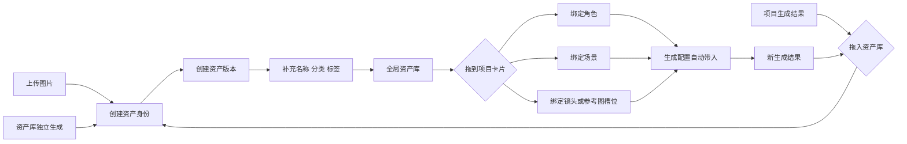

# 全局资产库第五阶段规划

> 本文只定义第五阶段的产品边界、数据关系和实施顺序；本轮不修改资产库数据结构。

## 1. 要解决的核心问题

当前资产库能够保存图片、从项目复制图片，也能把素材拖到部分生成卡片，但还缺少四个闭环：

1. 同一角色或场景的多个版本没有稳定的“资产身份”。
2. 素材被哪些项目、角色、场景和镜头使用，无法完整追踪。
3. 上传、项目生成、资产库独立生成三种来源的命名与分类不统一。
4. 删除、替换和重新生成可能破坏已有项目引用，缺少版本与回收机制。

第五阶段的目标不是再做一个图片列表，而是建立“可复用资产身份 + 可追踪版本 + 明确绑定”的素材系统。

## 2. 目标流程

## 3. 数据模型建议

### AssetIdentity：逻辑资产

代表“这是同一个谁/什么”，而不是某一张图片。

- `id`, `ownerId`, `title`, `kind`
- `description`, `status`（ACTIVE / ARCHIVED / TRASHED）
- `currentVersionId`
- `createdAt`, `updatedAt`, `deletedAt`

`kind` 第一版固定为：角色、场景、风格、道具/产品、品牌、通用参考。先用受控分类，不允许任意创建一级分类。

### AssetVersion：具体图片版本

- `id`, `assetIdentityId`, `storageKey`, `mimeType`, `width`, `height`
- `sourceType`（UPLOAD / PROJECT_RESULT / LIBRARY_GENERATION）
- `sourceProjectId`, `sourceOperationId`, `parentVersionId`
- `promptSnapshot`, `model`, `referenceSnapshot`
- `contentHash`, `createdAt`

同一资产可以有正面、侧面、不同服装或重生成版本；旧项目继续引用原版本，不随“当前版本”变化。

### AssetBinding：使用关系

- `assetIdentityId`, `assetVersionId`
- `projectId`
- `targetType`（CHARACTER / SCENE / SHOT / STYLE / STEP_REFERENCE）
- `targetKey`（角色 ID、场景 ID、镜头复合键等）
- `slot`（PRIMARY / SECONDARY / STYLE / PREVIOUS_SHOT 等）
- `priority`, `createdBy`, `createdAt`

绑定必须指向具体版本，同时保留逻辑资产身份，才能做到“项目稳定、资产可升级”。

### Tag：标签

- 一级分类由系统控制。
- 标签允许用户输入，但做大小写、空格和同义词归一。
- 系统自动标签与用户标签分开保存，避免 AI 覆盖人工整理。
- 支持颜色、时代、地域、人物特征、镜头用途等多标签筛选。

## 4. 交互约定

### 从资产库拖到项目卡片

1. 拖拽经过卡片时显示明确槽位，例如“角色主参考”“场景风格参考”。
2. 放下后先出现非阻塞确认条，展示资产、目标、槽位和优先级。
3. 确认后写入 `AssetBinding`，卡片显示“优先使用：资产名 · 版本号”。
4. 生成配置工作台自动读取绑定并按优先级列出；用户仍可在本次任务中移除或调序，但不默认修改永久绑定。

### 从项目结果拖到资产库

1. 放下即打开轻量保存卡，不直接静默创建。
2. 自动带出建议名称、分类、来源项目、生成模型和提示词。
3. 用户只需确认名称与分类；标签可稍后补充。
4. 保存为新资产，或搜索到相似资产后选择“作为新版本”。

### 上传与独立生成

- 资产库顶部统一一个“新建资产”入口，分为上传和生成两个方式。
- 上传先做文件校验、去重和基础元数据提取，再进入同一命名卡。
- 独立生成直接复用现有“配置、执行”工作台，只是目标从项目步骤变为资产身份；生成完成后先进入候选版本，由用户选择是否设为当前版本。

## 5. 删除与权限

- 默认删除进入回收站，30 天内可恢复。
- 已被项目绑定的版本不能硬删除；只能归档或解除绑定后删除。
- 用户资产默认私有；小组共享资产必须显式授权，并记录创建者、可编辑者和可使用者。
- R2 只保存对象，业务授权由 API 校验；数据库保存稳定 `storageKey`，前端只接收短时签名 URL。

## 6. 实施顺序

1. **数据底座**：新增身份、版本、绑定、标签和回收站表；迁移现有 `UserAsset`，保持旧 ID 可追踪。
2. **库内管理**：搜索、筛选、重命名、标签、版本切换、归档和恢复。
3. **双向拖拽**：资产库到角色/场景/镜头；项目结果到资产库；所有动作写统一绑定服务。
4. **生成接入**：九步生成配置从绑定服务读取参考图，首次生成和重试共享同一快照格式。
5. **独立生成**：复用生成工作台和真实任务进度，结果成为候选版本。
6. **治理与迁移收尾**：重复图片合并建议、引用审计、权限测试、旧接口下线。

每一阶段都应提供迁移回滚脚本、绑定一致性测试和至少一个真实项目的端到端验证。第一阶段不改变用户看到的图片，只建立兼容层；确认数据正确后再切换界面。

## 7. 开始实现前需要确认的三个产品选择

1. 小组资产是“复制到个人库”还是“共享同一资产身份”；建议共享身份、项目绑定具体版本。
2. 资产更新后，已有项目是否自动跟随；建议默认不自动跟随，只提示可升级。
3. 回收站保留期；建议 30 天，已绑定资产无限期保留且禁止硬删除。
