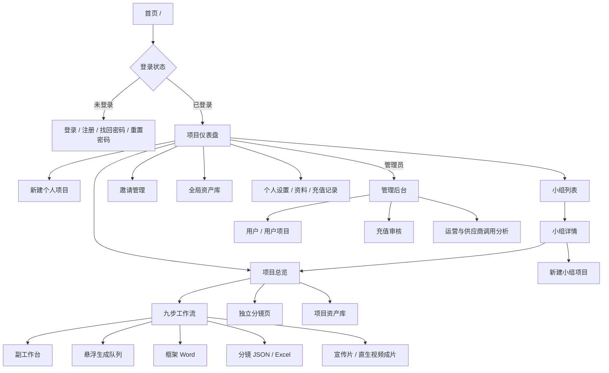
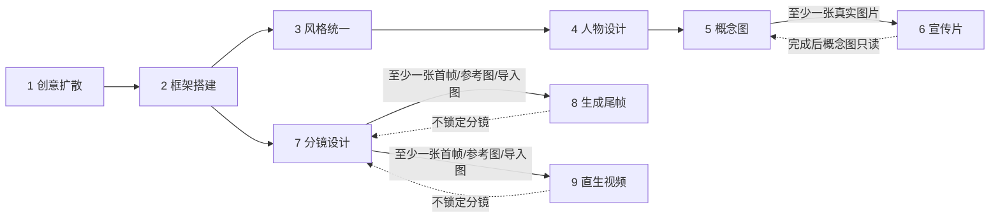
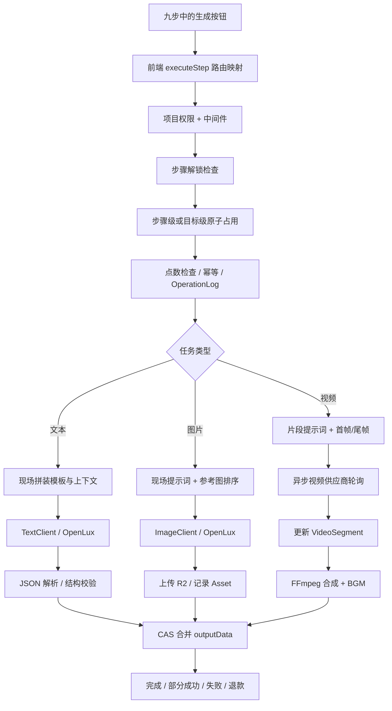
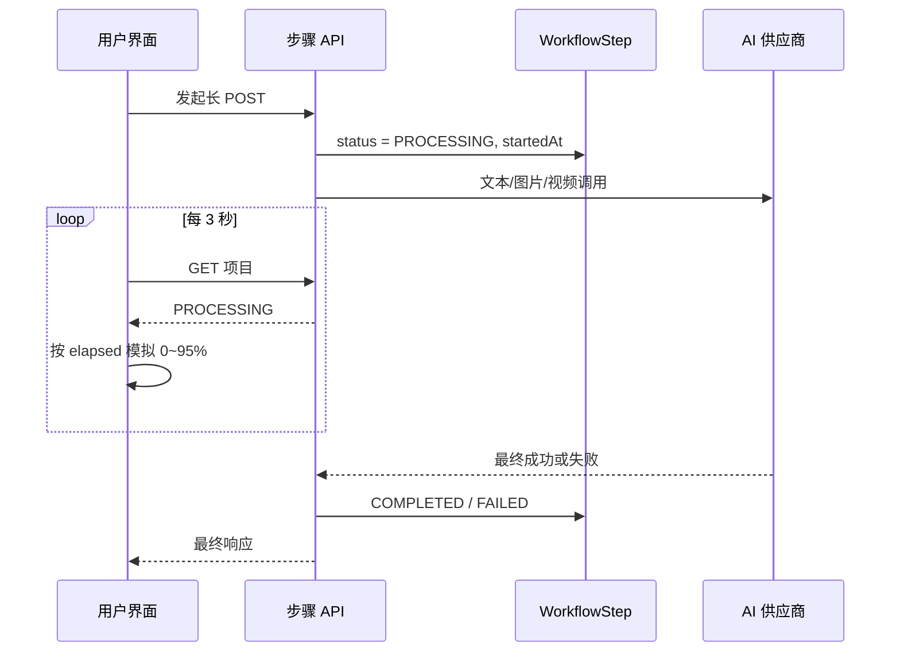
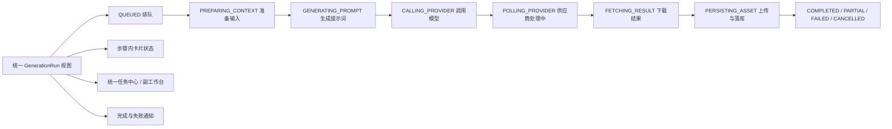
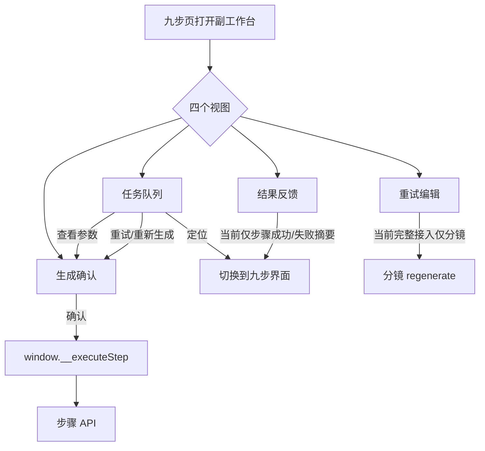

# 项目界面、九步生成与副工作台审查

> 审查日期：2026-10-19
> 口径：以当前代码真实调用链为准；“建议方案”尚未实现。

## 1. 结论摘要

1. 九步共用工作流外壳，但**不是同一个生成函数**。文本生成、图片生成、视频生成分别走不同客户端；每一步还有独立的提示词模板、输入拼装和参考图策略。
2. 当前进度条不是供应商真实进度。前端按开始时间模拟 0～95%，只轮询步骤的 `PENDING / PROCESSING / COMPLETED / FAILED`，因此长任务容易长期显示“正在生成”。
3. 数据库已经有可作为统一任务追踪骨架的 `OperationLog`、`ProviderCallAttempt`、`OperationResult`，但目前只有管理员接口读取，普通用户界面没有消费。
4. 副工作台已有四个视图，但尚未成为全生成任务的统一控制面：生成确认参数存在推断值，结果阶段没有接真实运行数据，重试编辑只完整接入分镜。
5. 本次已按产品规则修改状态机：概念图在宣传片完成后只读；宣传片必须至少已有一张概念图片才解锁；分镜设计、生成尾帧不再进入只读。

## 2. 服务器界面总览



主要页面：

| 区域 | 页面 | 作用 |
|---|---|---|
| 认证 | 登录、注册、忘记/重置密码 | 注册已统一到登录页注册模式，唯一标识为 `login` |
| 项目 | 仪表盘、新建项目、项目总览 | 创建与进入项目 |
| 制作 | 九步工作流、独立分镜页 | 核心 AI 生产界面 |
| 资产 | 全局资产库、项目资产库 | 查看、选择、下载生成资产 |
| 协作 | 小组、邀请、小组项目 | 团队协作与权限 |
| 用户 | 设置、资料、充值记录 | 账户维护 |
| 管理 | 用户、项目、充值、分析 | 管理和供应商可观测性 |

“导出”并非只有视频：当前存在框架 Word、分镜 JSON/Excel，以及宣传片/直生视频合成结果。视频结果在播放器和资产体系中查看、下载；它不是原来已删除的独立“导出步骤”。

## 3. 九步开启与只读逻辑



| 步骤 | 开启条件 | 进入只读的条件 | 备注 |
|---|---|---|---|
| 创意扩散 | 始终开启 | 框架完成 | 可回看历史结果 |
| 框架搭建 | 始终开启 | 风格、人物、概念或分镜任一完成 | 作为下游结构输入 |
| 风格统一 | 框架完成 | 分镜完成 | 选定风格会同步风格完成态 |
| 人物设计 | 风格完成/已有选中风格 | 分镜完成 | 支持人物单独重生成和指定参考图 |
| 概念图 | 人物完成 | **宣传片完成** | 概念步骤完成但无图片，不解锁宣传片 |
| 宣传片 | **至少一张概念图片** | 永不自动只读 | 概念图片来自关联资产或兼容旧输出 |
| 分镜设计 | 框架完成 | **永不自动只读** | 导入完整分镜后，只要表内有图即可开启后续 |
| 生成尾帧 | 分镜至少有一张可用图片 | **永不自动只读** | 批量及单镜头生成 |
| 直生视频 | 分镜至少有一张可用图片 | 永不自动只读 | 有尾帧则首尾帧，无尾帧则首帧生成 |

## 4. 九步界面与 AI 调用明细

| 步骤 | 前端主要操作 | 提示词如何产生 | AI / 函数路径 | 实际参考输入 | 产出与单独任务 |
|---|---|---|---|---|---|
| 创意扩散 | 生成方向、评估、深化、迭代 | 运行时加载 `ideation`；评估/深化为路由内动态提示词 | `getTextClient`; 有图时 `generateVision` | 原始创意、项目标签、全局参考图及标签 | 创意方向 JSON；评估、深化是独立调用 |
| 框架搭建 | 按选中方向生成、重新生成、深化、导入 | 运行时拼装框架提示词 | `getTextClient`; 有图时 `generateVision` | 原始创意/所选方向、片长、项目标签、全局参考图 | synopsis、acts、characters、visualStyle 等结构化框架 |
| 风格统一 | 先生成提示词，再生成 3 张风格图；单张重生成 | `style-generation` 现场生成，可在前端修改后再生图 | 文本客户端 + 图片客户端；三模型池可智能分配 | 框架视觉风格、项目标签、全局参考图 | 风格候选图；单张可重生成；选择结果成为后续风格基准 |
| 人物设计 | 生成角色提示词、批量生图、单人物重生成、分配参考图 | `character` 现场生成，可编辑提示词 | 文本客户端 + `generateCharacterPortrait` | 角色描述、选中风格图、风格文本、人物指定/全局参考图 | 人物肖像资产；每个人物是可单独生成目标 |
| 概念图 | 生成分幕/场景提示词、批量生图、逐幕单独生成、单图重生成 | `concept` 现场生成，可编辑 | 文本客户端 + `generateConceptScene` | 剧本幕/场景、风格图、相关人物图、全局参考图 | 场景概念图；逐幕和单图均可独立任务 |
| 宣传片 | 生成片段提示词、单段/全部视频、BGM、合成 | 每张概念图结合框架现场生成视频提示词 | `generateConceptSegmentPrompts` + `generateOneVideoSegment` + FFmpeg 合成 | 每段对应概念图；框架梗概/幕信息；视频提示词 | `VideoSegment` 单段任务、BGM、最终合成视频 |
| 分镜设计 | 生成分镜文本、按幕生图、单镜重生成、修改原图、导入 | `storyboard-act-dynamic` 先生成镜头；`storyboard-image-prompt` 再现场生成生图提示词 | 文本客户端 + OpenLux `generateImage` | 手工拖入图优先，其次人物图、风格图、上一镜头、全局参考图；编辑模式再以原图为主图 | 镜头表、首帧；按幕及单镜头任务；支持导入已有完整分镜 |
| 生成尾帧 | 生成尾帧提示词、批量生图、单镜生成 | 每个镜头用 `keyframe-last` 现场生成，可编辑 | 文本客户端 + `generateKeyframe` | 当前镜头首帧为主参考；人物图、风格图、全局参考图为辅助参考 | 每镜头尾帧；批量和单镜头任务 |
| 直生视频 | 生成片段提示词、单段/全部视频、BGM、合成 | 先按分镜生成初稿，再用 `video-prompt-from-context` 汇总首尾帧上下文 | `generateSegmentPrompts` + `generateOneVideoSegment` + FFmpeg 合成 | 分镜首帧/导入图为主；有尾帧时加入尾帧；镜头描述与尾帧提示词 | `VideoSegment` 单段任务、BGM、最终合成视频 |

### 模型与供应商选择

- 文本默认走 OpenLux 兼容层，通常为 `deepseek-v3`；视觉文本为 `gpt-4o-mini`；宣传片提示词失败时由 `deepseek-v3` 回退 `gpt-4o-mini`。
- 图片默认 `gpt-image-1`，用户可在可用模型池选择；风格统一另有 Flux、GPT Image 2、即梦 4.5 的三模型分配逻辑。
- 视频默认 `viduq2-turbo`，兼容 Wan 2.5、MiniMax Hailuo；编排层名称仍叫 `mockVideoClient`，但它会优先调用真实 OpenLux 视频接口，失败才回退本地 FFmpeg/Ken Burns。
- BGM 优先千问百聆，失败再尝试 MiniMax，最终允许静音兜底以避免阻断合成。

### 共用外壳与不同核心



所以答案是：**入口形式相似，底层生成函数并不相同**；即使同为图片，各步骤对主参考图、辅助参考图和提示词的构造也不同。

## 5. 当前进度显示的真实情况

### 当前态



当前问题：

- 百分比由耗时模拟，不代表真实供应商进度。
- 普通步骤只有四态，不能告诉用户是在排队、生成提示词、上传、供应商轮询还是合成。
- `generation-heartbeat` 只刷新 `updatedAt` 防止任务被误判死亡，不产生阶段事件。
- 视频单段已有 `pending / generating / completed / failed`，分镜也有镜头级状态，但各自实现，尚未统一。
- `OperationLog` 和 `ProviderCallAttempt` 已记录更多数据，却没有用户可读接口。

### 建议的统一目标态（本次未实现）



建议数据字段：

| 字段 | 含义 |
|---|---|
| runId / operationId | 一次用户生成意图的稳定 ID |
| stepName / targetType / targetKey | 步骤、幕、镜头、角色或视频段定位 |
| stage / message | 当前真实阶段与用户可读说明 |
| completedUnits / totalUnits | 批量任务真实完成数，例如 3/12 镜头 |
| progress / progressSource | 仅供应商返回或可由单元数计算时展示百分比 |
| provider / model / externalTaskId | 实际供应商与外部任务 |
| heartbeatAt / startedAt / updatedAt | 存活状态与耗时 |
| retryable / errorCode | 是否可重试及明确失败原因 |

展示原则：

- 有真实百分比：显示百分比和阶段。
- 有批量单元：显示“已完成 3/12”，百分比可由单元数计算。
- 两者都没有：只显示阶段、耗时和存活心跳，**不伪造百分比**。
- 第一阶段可继续用 3 秒轮询；稳定后改 SSE 推送，保留轮询作为断线兜底。
- 用现有 `OperationLog` 做主干，补充面向用户的安全投影 API，而不是再建一套互不相通的状态。

## 6. 副工作台审查

### 当前流程



功能成熟度：

| 模块 | 当前能力 | 完整性判断 |
|---|---|---|
| 任务队列 | 把九步按失败、生成中、待处理、可迭代分类 | 部分可用；所有 `PENDING` 都归“已解锁”，未按 DAG 区分等待依赖 |
| 生成确认 | 展示依赖、模型、比例、提示词、点数 | 未完全真实；常回退 `gpt-image-1`、5 点和首条提示词，未绑定实际 action |
| 结果反馈 | 展示预览、失败信息、阶段 | 阶段构造函数未接入，成功时通常无阶段，部分成功与保留资产为空 |
| 重试编辑 | 修改提示词、参考图、原图编辑 | 分镜较完整；人物、概念、风格、尾帧、视频段未统一接入 |
| 调用耦合 | 通过 `window.__...` 在页面和抽屉之间通信 | 可运行但脆弱，难以类型校验和复用 |

结论：副工作台**可以演进成所有生成任务的统一外壳，但当前还不能称为全任务通用且功能健全**。

建议把每类生成注册为统一 `TaskAdapter`：

```text
TaskAdapter = {
  buildConfirmation(),
  submit(),
  getProgress(),
  getResult(),
  retry(),
  cancel(),
  editableFields,
  referencePolicy
}
```

九步页、资产卡片、副工作台和悬浮队列都只消费同一任务对象，避免各自猜模型、点数和状态。

## 7. 推荐实施顺序

1. 先定义统一任务状态和用户可读的 operation API，不改现有生成算法。
2. 先接视频段、分镜按幕/按镜头两类已有细粒度状态，验证 UI。
3. 将图片批量任务接为 `completedUnits / totalUnits`。
4. 将纯文本任务接为阶段式进度，不显示虚假百分比。
5. 副工作台改为消费真实任务对象，移除 `window.__...` 和推断参数。
6. 最后统一悬浮队列、步骤卡片、结果反馈和失败重试。

## 8. 本次代码变更与验证

- 状态机增加“概念图实际有图”派生状态，同时兼容关联 `IMAGE` 资产和旧 `outputData`。
- 调整概念图、宣传片、分镜、尾帧的开启/只读规则。
- 项目详情 API 与后端执行守卫使用同一派生状态，避免前端已解锁但后端拒绝。
- 新增对应回归测试。
- 验证结果：`npm test` 54 通过、0 失败；`npx tsc --noEmit` 通过。
